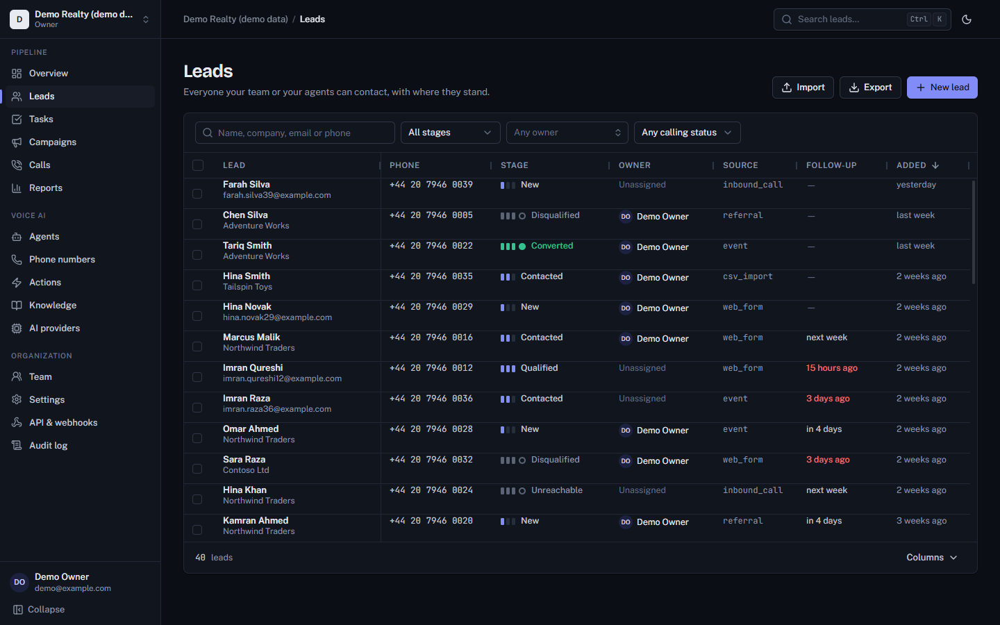
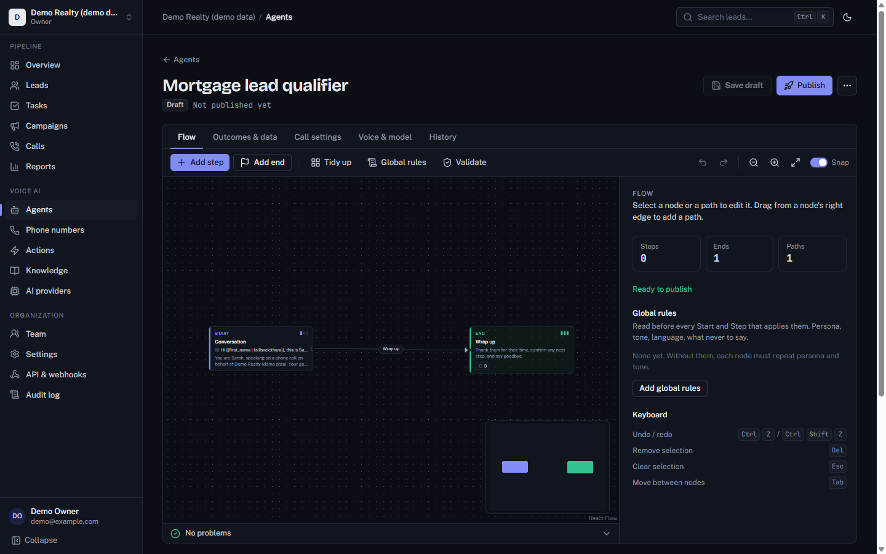
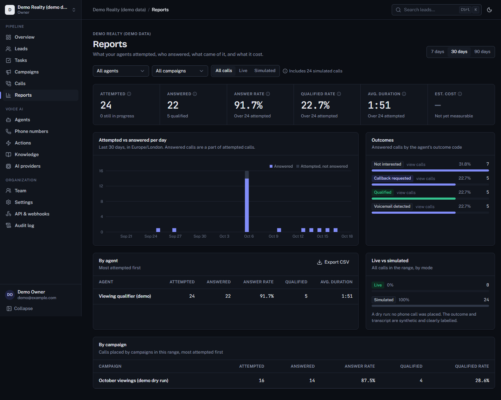

<p align="center">
  <picture>
    <source media="(prefers-color-scheme: dark)" srcset="docs/brand/atlas-wordmark-white.png">
    
  </picture>
</p>

# AI Voice Agent & CRM Platform

Multi-tenant platform for managing leads, configuring AI voice agents, running controlled
calling campaigns, and measuring outcomes. *ATLAS is a working codename; branding is
configurable via `ATLAS_PRODUCT_NAME`.*

## Status

| Milestone | State |
|---|---|
| 1 Foundation | ✅ |
| 2 Auth & CRM (API) | ✅ |
| 3 Web app (CRM) | ✅ Radix controls, AG Grid leads |
| 4 Voice runtime, agents, calls | ✅ 276 backend tests on PostgreSQL + 7 live runtime contract tests |
| 5 Campaigns, calls, reports, flow canvas | ✅ |
| 7 API keys, webhooks, phone numbers, actions, knowledge | ✅ |
| 6, 8 Local models end-to-end, hardening | ⬜ see `docs/implementation-plan.md` |

## Requirements

| Tool | Version |
|---|---|
| Docker Desktop / Engine | 24+ (Compose v2) |
| Python | 3.12 (installed automatically by `uv`) |
| uv | 0.8+ |
| Node.js | 22 LTS (web app) |
| pnpm | 10 |

## First run

```bash
cp .env.example .env              # then set ATLAS_JWT_SECRET and ATLAS_SECRETS_ENCRYPTION_KEY
docker compose up -d postgres redis
cd services/api
uv sync
uv run alembic upgrade head
ATLAS_DEMO_PASSWORD='choose-one' uv run python -m app.seed   # optional synthetic demo data
uv run uvicorn app.main:app --reload --port 8080
```

* API docs: <http://localhost:8080/docs> (Swagger) · <http://localhost:8080/redoc>
* Health: <http://localhost:8080/api/v1/health/ready>
* Worker: `uv run arq app.workers.main.WorkerSettings`

Web app (second terminal):

```bash
cd apps/web
pnpm install
pnpm dev            # http://localhost:5173 (proxies /api to :8080)
pnpm gen:api        # regenerate src/types/api.d.ts after API changes
```





Windows: every command above works in PowerShell. Or use the task runner: `.\make.ps1 infra`,
`.\make.ps1 dev-api`, `.\make.ps1 check`. On Linux/macOS: `make infra`, `make dev-api`, ….

## Quality gates

```bash
cd services/api
uv run ruff check app tests && uv run ruff format --check app tests
uv run mypy app          # strict
uv run pytest -q         # needs the compose postgres + redis (uses db atlas_test, redis db 15)
uv run alembic check     # models and migrations in sync
```

## Documentation

Brand assets (wordmark and mark as SVG and PNG, light and dark) live in `docs/brand/`. The web app renders the same geometry inline from `apps/web/src/components/brand.tsx`, filled with the current text colour.

* [Architecture](docs/architecture.md)
* [Implementation plan](docs/implementation-plan.md)
* Decisions: [0001 runtime adapter](docs/decisions/0001-modular-monolith-and-runtime-adapter.md) ·
  [0002 auth & tenancy](docs/decisions/0002-auth-tokens-and-tenancy.md) ·
  [0003 call completion](docs/decisions/0003-voice-runtime-call-completion.md)
* Feature docs: [calls](docs/calls.md) · [campaigns](docs/campaigns.md) · [API keys](docs/api-keys.md) ·
  [webhooks](docs/webhooks.md) · [local models](docs/local-models.md)
* [Third-party notices](THIRD_PARTY_NOTICES.md)

## Safety defaults

Real phone calls are disabled unless `ATLAS_LIVE_CALLS_ENABLED=true` **and** the campaign is
launched by a user holding `campaigns:launch_live`. Operators are responsible for call
disclosure, recording consent, opt-out handling, and local calling regulations.
